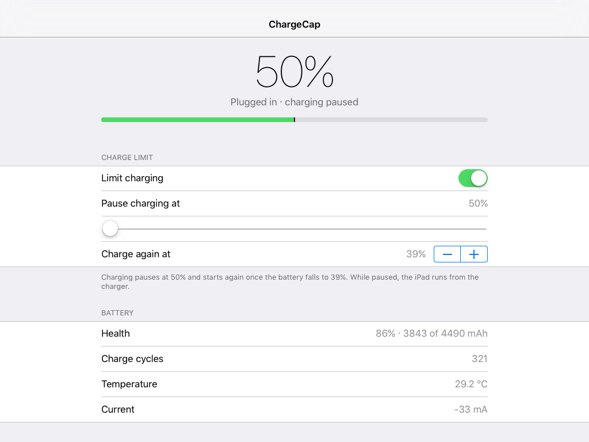

# ChargeCap

Stops a jailbroken iOS 9 iPad charging past a percentage you choose, to slow battery wear.
Built for, and tested on, an iPad mini 1 (iPad2,5) on iOS 9.3.5 with the iocaste jailbreak.
That jailbreak has no Mobile Substrate, so this is a daemon and an app, not an injected tweak.



## Installing

A Cydia repo is planned. Until it exists, download the `.deb` from
[Releases](https://github.com/LBSiUK/ChargeCap/releases), copy it to the device, and run this as root:

```
dpkg -i uk.lbsi.chargecap_1.0.0_iphoneos-arm.deb
```

The daemon starts straight away, and the ChargeCap app appears on the home screen.

## How it works

- **`chargecapd`** (a root LaunchDaemon) holds powerd's `ChargeInhibit` power assertion once
  the battery reaches the limit, and drops it when the battery falls to the resume level.
  While paused, the iPad runs from the charger and the battery holds at about −5 mA.
- powerd drops that assertion when the holding process dies. So a crash, a kill or an
  uninstall can never leave the iPad unable to charge. launchd restarts the daemon within a second.
- While charging up to the limit, the daemon also holds `PreventUserIdleSystemSleep`, so the
  iPad can't sleep straight past the limit. That hold is released once charging pauses.
- If powerd ever fails to stop the charger, the daemon asks again. If that fails too, it writes
  `IsCharging=false` to the charger itself and undoes that write when it stops.
  (`/var/run/chargecapd.forced` marks that state; `prerm` clears it.)
- Settings live in `/var/mobile/Library/Preferences/uk.lbsi.chargecap.plist`. The daemon
  rereads them on a Darwin notification and every 60 s.

## Using it

The **ChargeCap** app on the home screen shows the battery, a limit switch, a "Pause charging at"
slider (50–100%), a "Charge again at" stepper and battery health. The defaults are 80% / 75%.

Over SSH:

```
chargecap                  # battery, limit, health, whether the daemon runs
chargecap limit 60         # pause at 60% (the resume level keeps its gap below the limit)
chargecap resume 40        # charge again at 40%
chargecap on | off
chargecap log              # last 20 lines of /var/mobile/Library/Logs/ChargeCap.log
```

The log records each pause and resume. While plugged in, it also records each time the iPad
sleeps or wakes, so you can check it never slept while charging towards the limit.

## Building

```
tools/make_sdk.sh          # once: builds ~/sdks/iPhoneOS9.3-armv7.sdk
./build.sh                 # build/uk.lbsi.chargecap_1.0.0_iphoneos-arm.deb
./build.sh install         # also installs it on root@192.168.0.161 (IPAD=... to change)
```

Today's Xcode still links 32-bit armv7, but it takes three workarounds:

1. **`-marm`.** The linker no longer sets the Thumb bit on the entry point, so a Thumb `main`
   starts in ARM mode and dies with a bus error. ARM-mode code has no bit to lose.
2. **Converted stubs.** theos's iOS 9.3 `.tbd` files also list i386/x86_64, so they get
   read as iOS Simulator and refused. `make_sdk.sh` keeps only armv7 and marks it as iOS.
3. **Missing libc symbols.** Those stubs lack the armv7 `strcmp`, `memcpy` and similar.
   `make_sdk.sh` declares them in `libsystem_platform`, and libSystem re-exports them on the device.

On the device, replace binaries by rename and never overwrite them in place. iOS caches the old
code signature and kills the new binary with `Killed: 9`.

`tools/probe.c` is the IOKit probe used to find the charger controls (`probe props IOPMPowerSource`,
`probe get`, `probe set`, `probe assert`, `probe assertions`). It isn't part of the package.

## Uninstalling

Remove ChargeCap in Cydia, or run `dpkg -r uk.lbsi.chargecap`. `prerm` stops the daemon, and charging
returns to normal straight away. Purging the package also deletes the settings and the log.
