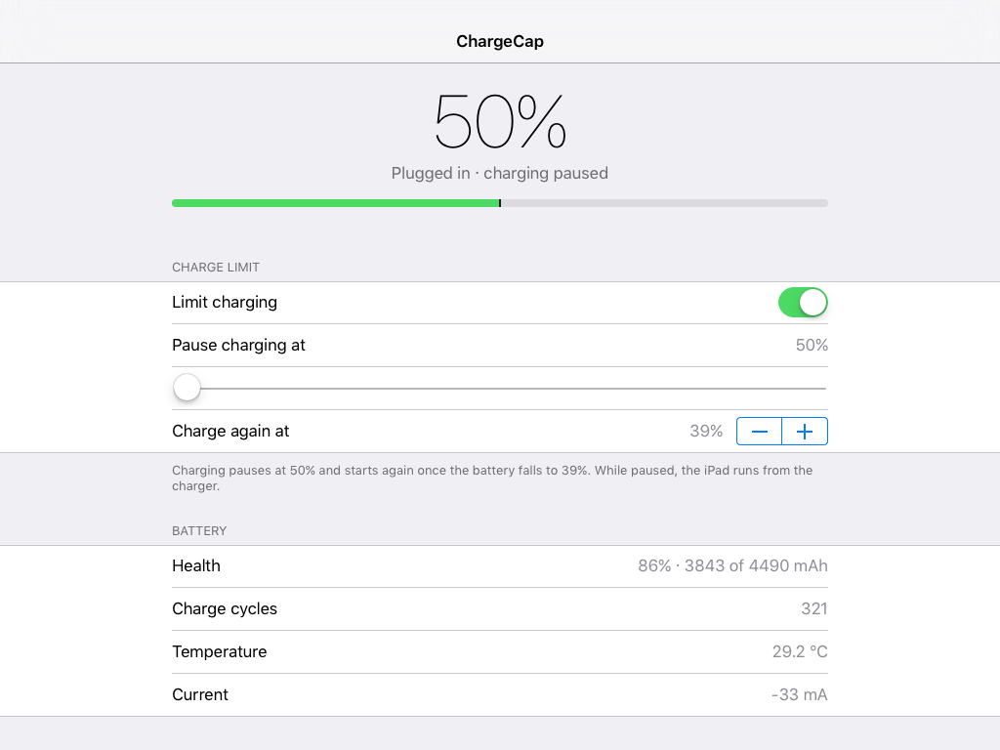

# ChargeCap

Stops a jailbroken iPad charging past a percentage you choose, to slow battery wear. It is a daemon
and an app, not an injected tweak, so it needs no Mobile Substrate or ElleKit.

| | iOS 15 | iOS 9 |
|---|---|---|
| Tested on | iPad Air 2 (iPad5,3), iOS 15.8.4, palera1n rootless | iPad mini 1 (iPad2,5), iOS 9.3.5, iocaste |
| Package | `iphoneos-arm64`, installs under `/var/jb` | `iphoneos-arm`, rootful |
| Runs a battery above the limit down to it | Yes | No, it holds the level |

On iOS 9: Tested and working that this survives reboots. I've only tested this on an iPad mini 1st Gen for the moment so it would be massively appreciated if others are willing to test this on other devices running iOS 9.

On iOS 15: a reboot and pulling the cable out are not tested yet. Reports from other devices are welcome here too.



## Installing

Both versions are in the same repo, `https://repo.lbsi.uk/`. The package manager picks the right one
for the device.

- **iOS 9 (Cydia):** go to Sources, tap Edit, then Add, and enter `https://repo.lbsi.uk/`.
  Or open [repo.lbsi.uk](https://repo.lbsi.uk/) in Safari on the device and tap Add to Cydia.
- **iOS 15 (Sileo or Zebra):** open Sources, tap +, and enter `https://repo.lbsi.uk/`.

Then install ChargeCap from the repo.

Without Cydia, download the `.deb` from [Releases](https://github.com/LBSiUK/ChargeCap/releases),
copy it to the device, and run `dpkg -i` on it as root: `uk.lbsi.chargecap_<version>_iphoneos-arm64.deb`
for iOS 15 and `uk.lbsi.chargecap_<version>_iphoneos-arm.deb` for iOS 9.

The daemon starts straight away, and the ChargeCap app appears on the home screen.

## How it works

- **`chargecapd`** (a root LaunchDaemon) holds powerd's `ChargeInhibit` power assertion once
  the battery reaches the limit, and drops it when the battery falls to the resume level.
  While paused, the iPad runs from the charger and the battery holds at about −5 mA.
- A pause only holds the level where it is. So on iOS 15, a battery above the limit is run down
  with powerd's `DisableInflow` assertion: the charger stops feeding the iPad, cable still in, until
  the battery is back at the limit. iOS's percent can rebound a point or two after that, so a new run
  only starts once the battery is more than 2 points above the limit. The status bar keeps its
  charging icon during this, because iOS draws it whenever the cable is in. The ChargeCap app shows
  the real state.
- While the screen is off, the resume level drops to its own lower setting, and a charge already
  under way pauses once the battery is above that level. Nothing runs the battery down to that level.
- powerd drops both assertions when the holding process dies. So a crash, a kill or an
  uninstall can never leave the iPad unable to charge. launchd restarts the daemon within a second.
- While charging up to the limit or running down to it, the daemon also holds
  `PreventUserIdleSystemSleep`, so the iPad can't sleep straight past the limit. That hold is released
  once charging pauses.
- If powerd ever fails to stop the charger, the daemon asks again. If that fails too, it writes
  `IsCharging=false` to the charger itself and undoes that write when it stops.
  (`/var/run/chargecapd.forced` marks that state; `prerm` clears it.)
- Settings live in `/var/mobile/Library/Preferences/uk.lbsi.chargecap.plist`. The daemon
  rereads them on a Darwin notification and every 60 s.

## Using it

The **ChargeCap** app on the home screen shows the battery, a limit switch, a "Pause charging at"
slider (50–100%), "Charge again at" and "With the screen off, at" steppers, and battery health.
The defaults are 80% / 75%, and the screen-off level starts the same as "Charge again at".

Over SSH:

```
chargecap                  # battery, limit, health, whether the daemon runs
chargecap limit 60         # pause at 60% (the resume level keeps its gap below the limit)
chargecap resume 40        # charge again at 40%
chargecap screenoff 30     # while the screen is off, charge again at 30%
chargecap on | off
chargecap log              # last 20 lines of /var/mobile/Library/Logs/ChargeCap.log
```

The log records each pause and resume. While plugged in, it also records each time the iPad
sleeps or wakes, so you can check it never slept while charging towards the limit.

## Building

```
tools/make_sdk.sh          # once: builds ~/sdks/iPhoneOS9.3-armv7.sdk
./build.sh                 # both debs in build/
./build.sh install         # also installs on mobile@192.168.0.11 (IPAD=root@192.168.0.161 for the mini)
```

The iOS 15 slice uses Xcode's own SDK. iOS 15 kills a fake-signed binary at launch unless it claims
`platform-application`, and that entitlement brings a stricter sandbox policy, so the daemon also needs
an exception to open `RootDomainUserClient` for its sleep and wake notifications
(`packaging/chargecapd.entitlements`).

Today's Xcode still links 32-bit armv7, but it takes three workarounds:

1. **`-marm`.** The linker no longer sets the Thumb bit on the entry point, so a Thumb `main`
   starts in ARM mode and dies with a bus error. ARM-mode code has no bit to lose.
2. **Converted stubs.** theos's iOS 9.3 `.tbd` files also list i386/x86_64, so they get
   read as iOS Simulator and refused. `make_sdk.sh` keeps only armv7 and marks it as iOS.
3. **Missing libc symbols.** Those stubs lack the armv7 `strcmp`, `memcpy` and similar.
   `make_sdk.sh` declares them in `libsystem_platform`, and libSystem re-exports them on the device.

On the device, replace binaries by rename and never overwrite them in place. iOS caches the old
code signature and kills the new binary with `Killed: 9`. A palera1n reboot leaves the jailbreak, so
the daemon comes back once the iPad is jailbroken again, alongside the other `/var/jb` daemons.

`tools/probe.c` is the IOKit probe used to find the charger controls (`probe props IOPMPowerSource`,
`probe get`, `probe set`, `probe assert`, `probe assertions`). It isn't part of the package.

## Uninstalling

Remove ChargeCap in Cydia or Sileo, or run `dpkg -r uk.lbsi.chargecap`. `prerm` stops the daemon, and charging
returns to normal straight away. Purging the package also deletes the settings and the log.
